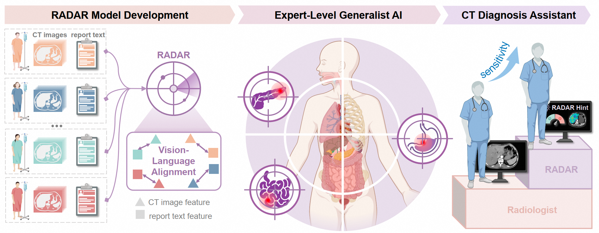

# RADAR: An Expert-Level Generalist AI for Abdominal CT Diagnosis

Artificial intelligence (AI) in radiology aspires to deliver expert-level diagnosis across diverse clinical tasks, yet existing supervised strategies remain limited in scope. We developed **RADAR**, a generalist vision–language model trained on more than **400,000** contrast-enhanced abdominal CT examinations and **15 million** anatomy-wise image–text pairs, learning directly from clinical reports without manual annotation. Across extensive internal and external evaluations spanning multiple centers and varied scenarios, RADAR achieved high diagnostic performance and robust generalization for **18 anatomical structures** and **146 imaging findings**. In a reader study, AI assistance increased the diagnostic sensitivity of 26 radiologists by approximately 10%, underscoring its clinical utility. In summary, RADAR offers a scalable, versatile, and interpretable solution, demonstrating that generalist AI can match human experts in both routine and complex radiology tasks.

<p align="center">
  
</p>

---

## Setup

Create a conda environment and install the required dependencies:

```bash
conda create -n radar python=3.10
conda activate radar
pip install -r requirements.txt
```

---

## HuggingFace

- The pre-trained checkpoints and supporting files are available on [HuggingFace](https://huggingface.co/radar-generalist).
- For convenience, we have provided the demo nifty, processed Merlin-related reports and labels, and predicted results in CSV format in this repo. The supporting files required for inference demo and training can be downloaded from HuggingFace.

---

## Documentation

For detailed instructions, please refer to the following guides:

| Guide                         | Description                                                                                                                               |
| ----------------------------- | ----------------------------------------------------------------------------------------------------------------------------------------- |
| [Training](docs/TRAINING.md)   | Train RADAR/RADAR+ from scratch or fine-tune on MERLIN data; inference and evaluation are also included.                                                   |
| [Inference](docs/INFERENCE.md) | 1. An inference demo with a radar pre-trained checkpoint on RAD-CT, and 2. Inference and evaluation of radar performance on the external MERLIN test set. |

---

## Reproduction UI

This repository includes a Streamlit interface for reproducing RADAR inference
with a pretrained checkpoint. It supports NIfTI upload, CT preview, low-memory
sliding-window inference, probability charts, result tables, and CSV export.

### Windows

```powershell
conda create -n radar python=3.10 -y
conda activate radar
pip install torch==2.7.1 torchvision==0.22.1 --index-url https://download.pytorch.org/whl/cu128
pip install -r requirements.txt
.\start_ui.ps1
```

### Ubuntu

```bash
git clone https://github.com/vickyhan-003/radar-reproduction-ui.git
cd radar-reproduction-ui
conda create -n radar python=3.10 -y
conda activate radar
pip install torch==2.7.1 torchvision==0.22.1 --index-url https://download.pytorch.org/whl/cu128
pip install -r requirements.txt
```

Download the required model files from
[Alibaba-DAMO-Academy/RADAR](https://huggingface.co/Alibaba-DAMO-Academy/RADAR):

```text
ckpt/
├── checkpoint_radar_pretrain.pth
└── bert-base-chinese/
    ├── config.json
    ├── config_decoder.json
    ├── pytorch_model.bin
    ├── tokenizer.json
    ├── tokenizer_config.json
    └── vocab.txt
```

Place a `.nii.gz` abdominal CT in `data/demo_cases/`, then start the UI:

```bash
streamlit run radar_ui.py
```

The default `64 × 160 × 224` sliding window is intended for an 8 GB GPU. The
paper's original `96 × 256 × 384` window remains selectable for larger GPUs.
The low-memory path uses FP16 model inference and CPU mask stitching; this may
produce small numerical differences from the original server configuration.

Model weights and medical images are intentionally excluded from GitHub.
This project is for research and coursework reproduction only, not clinical use.

---

## Citation

If you find RADAR useful in your research, please cite our paper:

```bibtex
@article{radar,
  title   = {RADAR: An Expert-Level Generalist AI for Abdominal CT Diagnosis},
  year    = {2026},
  note    = {BibTeX entry to be updated upon publication}
}
```
